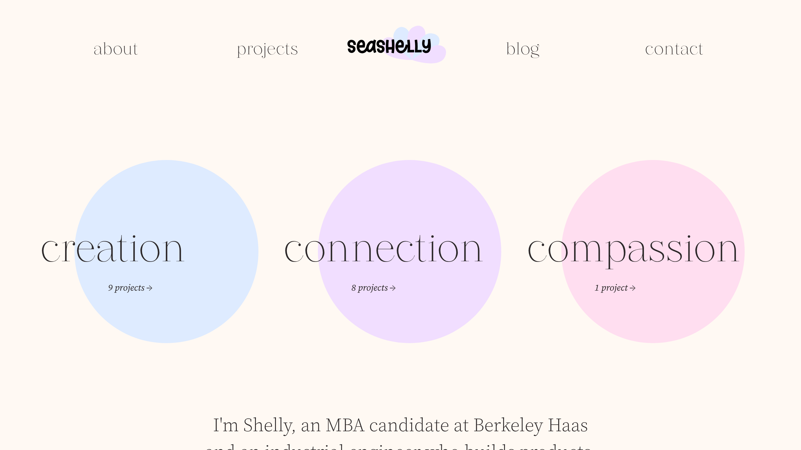

### Hi, I'm Shelly (seashelly) 🐚

MBA student at Berkeley Haas who builds products and businesses zero-to-one.
I've used Python for data analysis in the past, and I'm now learning to build real things myself with AI coding tools, one small project at a time.

**I create for connection, with compassion.**

#### 🔭 Currently building

**[seashelly.vercel.app](https://seashelly.vercel.app)** · my portfolio site
- Archives my startups, design work, parties and writing as projects grouped into collections
- `Astro` · `Vercel` · built with `Claude Code`
- Every change goes out on its own branch with a Vercel preview link before it goes live

**[wedding-run-poodle](https://leesohyunee.github.io/wedding-run-poodle/)** · the game I made as our wedding invitation
- Just started rebuilding it as v2

**Small AI tools for everyday life** · starting with a goal and habit tracker for my MBA life

#### 🌱 Currently learning
- How the pieces of a web app fit together: frontend, server and database, through Vercel, Cloudflare and Supabase
- Shipping safely with Git, GitHub and Vercel: branches, preview links and going live
- Working with AI coding agents: clear rules (CLAUDE.md), a shared progress log, and reviewing changes before I publish

#### 📁 My Experience
I've spent my career on the business side of tech. I was a product strategist for an autonomous blood-drawing robot, led zero-to-one EMEA market entry for AI MRI software, and co-founded two startups.
I'm used to turning user research into product requirements and working closely with engineers. Now I'm learning to build some of it myself.

#### 🛠 Tools
- **Design:** Illustrator, Photoshop, Premiere, After Effects, Figma
- **Building (learning):** Python, Astro, Git, Vercel, Supabase, Cloudflare, Claude Code, Cursor
- **Operations:** Notion automations, Excel, Salesforce

#### 📝 Learning in public
I write short notes on what I learn while building in **[TIL](https://github.com/leesohyunee/TIL)** (Today I Learned).

#### 📫 Find me
[Website](https://seashelly.vercel.app) · [LinkedIn](https://www.linkedin.com/in/leesohyunee/) · shellylee@berkeley.edu
